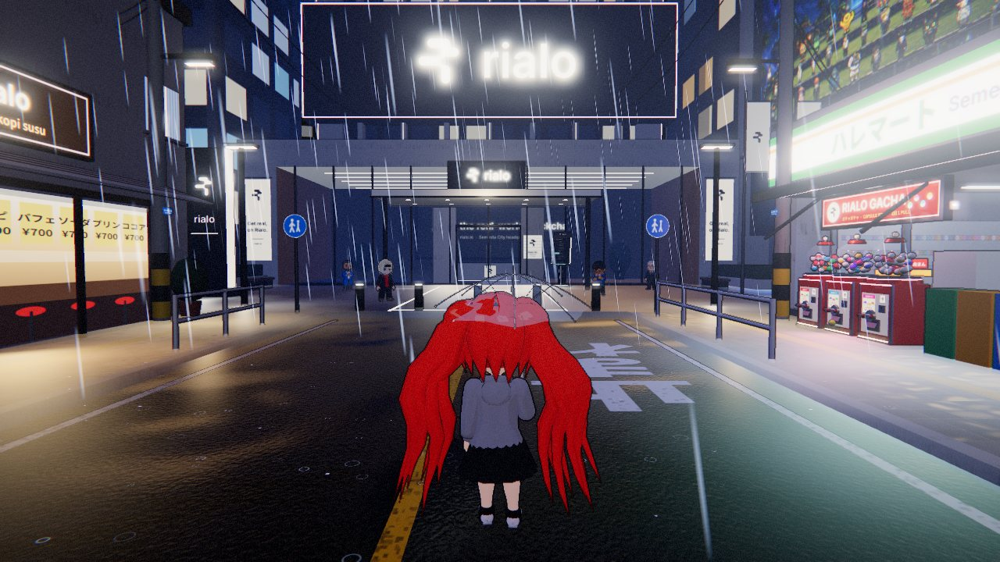
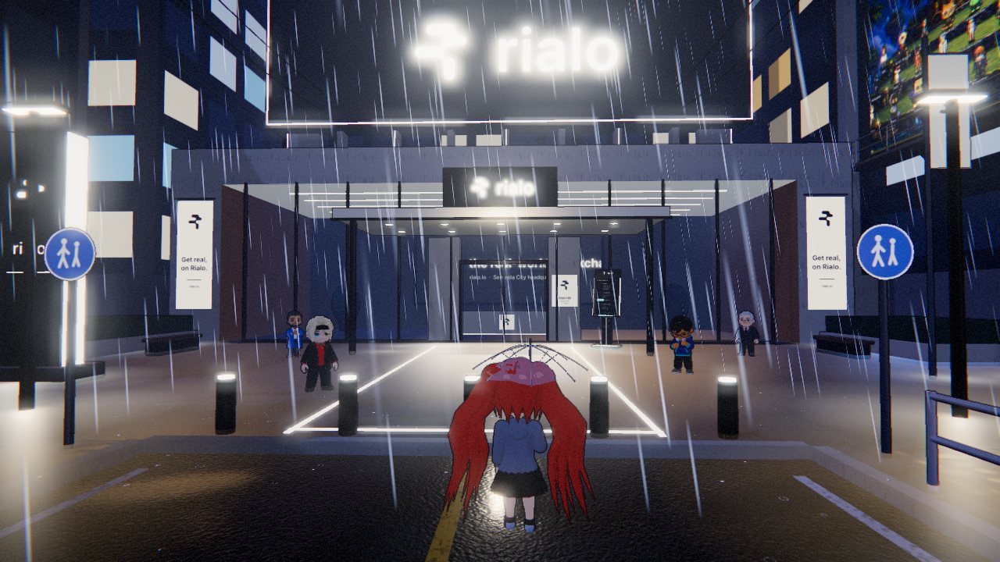
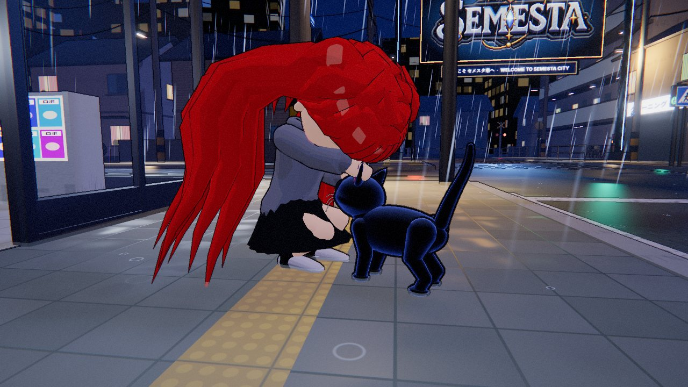
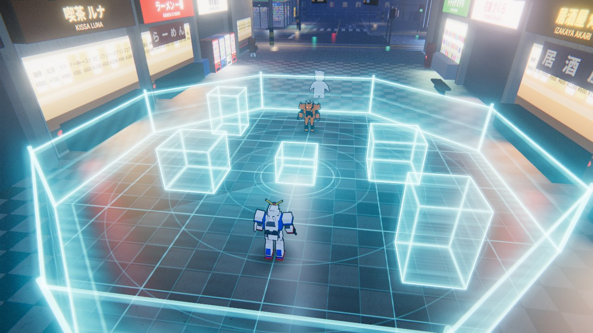
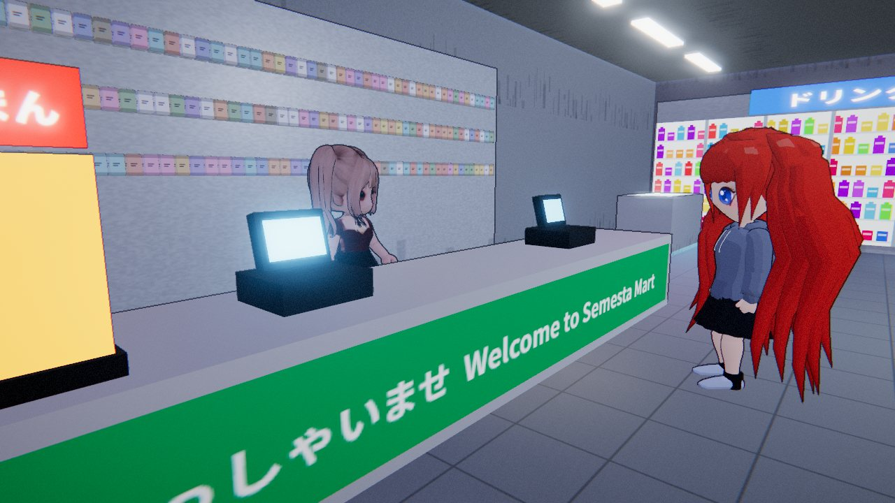
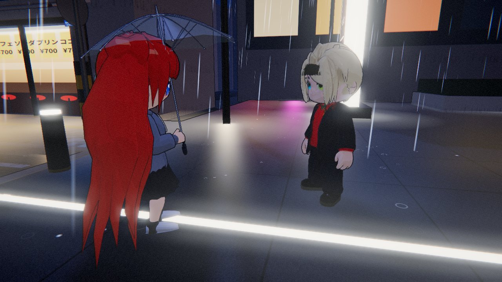

<div align="center">

# Semesta City · Rainy Night

**A rainy-night anime city that runs in your browser.**
Make your character, walk the wet neon streets, meet the Rialo crew, pet a black cat called Spider,
and win a holographic robot battle. Runs on desktop and on phones.

[**▶ Play now**](https://semestacity.vercel.app) · [How to play](#how-to-play) · [Run locally](#run-locally) · [Project layout](#project-layout)




</div>

## What's inside

| | |
|---|---|
|  | **Rialo HQ.** Eric, Ade, Koushik and Rollins explain how Rialo works: real-world data, reactive transactions, identity and privacy, and the agent economy. Finish their topics to earn badges, then take the Rialo quiz. |
|  | **Spider the cat.** He roams the city on his own. Crouch down to pet him, set a bowl of food in front of him, or toss him a yarn ball and watch him pounce. He'll follow you around if you ask. |
|  | **Holo-battle.** Challenge Dikzzy on the holo-table: a small arena shooter with guns, lobbed bombs, homing pods, dashes and air-dashes. |
|  | **Semesta Mart and the Gacha.** Littlechip runs the corner store. Outside are the Rialo Gacha machines, where you spend $RIALO on hats, auras, umbrellas and titles. |
|  | **Your own character.** Pick a face, hair, outfit and colours in the creator, then show them off in the rain. The camera finds a clear angle in every conversation. |

There's more to find:

- **Simulated Rialo testnet wallet.** It has an identity, a custodial keypair, a daily faucet, points and an activity log. Everything is stored locally; there's no real network and there are no real tokens.
- **Two languages.** English and Bahasa Indonesia, switchable in Settings.
- **Mobile controls.** Phones get a floating joystick, swipe-to-look, and contextual action buttons. Touchscreen laptops switch to them on the first touch.
- **Atmosphere.** A cinematic loading screen, synthesized lo-fi music and rain, wet reflections, bloom and toon outlines.

## How to play

### Explore

| Desktop | Phone | Action |
|---|---|---|
| `W` `A` `S` `D` | Left thumb (joystick) | Move |
| `Shift` (hold) | Push the stick far, or tap `»` | Run |
| `Space` | `⤒` | Jump |
| Mouse drag or click-lock | Swipe on the right half | Look around |
| `Q` / `R`, mouse wheel | — | Turn and zoom the camera |
| `E` | Big `E` button | Talk or interact |
| `P` | Menu → Wallet | Rialo Playground wallet |
| `H` | — | Show or hide the key strip |
| `Esc` | `☰` | Pause and menu |

### Holo-battle

| Desktop | Phone | Action |
|---|---|---|
| Left click / `J` | `✸` | Gun |
| Right click / `K` | `◉` | Bomb |
| `E` / `Q` | `◆` | Pod |
| `Shift` | `»` | Dash |
| `Space` (again in the air to air-dash) | `⤒` | Jump |

### $RIALO and the Gacha

- Claim 5 $RIALO a day from the faucet in the wallet (`P`, or the Playground kiosk outside Rialo HQ).
- Badges, a passed quiz and battle wins also pay out.
- Gacha: 1 pull costs 1 $RIALO, and 10 pulls cost 9. Prizes come in four rarities. Equip them from the Collection tab; some come with small gameplay perks.

## Run locally

You need Node.js 18 or newer.

```bash
npm install
npm run dev
```

Then open the URL Vite prints (http://localhost:5173 by default).

```bash
npm run build     # static site -> dist/
npm run preview   # serve the production build locally
```

### Deploy

The game builds to a plain static site, so any static host works. `vercel.json` sets up Vercel: it runs `npm run build`, serves `dist/`, and adds long-lived cache headers for the hashed assets, the character models and the brand art.

```bash
npx vercel --prod
```

## Project layout

```
index.html            entry page (canvas + UI root)
style.css             global UI styles
public/
  models/             the 8 cast members as rigged .glb files
  brand/              Semesta logo, Rialo Builder Hub banner, NXR mascot art
src/
  main.js             boot, loading, game state machine, cameras, dialogs, cat interactions
  core/               renderer + post FX, player controller, input (keyboard/mouse/touch), audio, collision, saves
  world/              the city: streets, Rialo HQ, Semesta Mart, arcade, houses, rain, decals, gacha machines
  characters/         procedural player avatar, GLB cast loader, animation, NPC behaviour, Spider, NXR
  combat/             holo-table battle: arena, robots, weapons, AI, FX, HUD
  systems/            simulated testnet wallet, gacha logic, gear perks
  ui/                 loading screen, menus, HUD, dialog box, touch controls, creator, wallet, gacha
  data/               NPC dialogue and quiz (EN / ID), gacha catalog
  gfx/                toon materials, Rialo mark
tests/                standalone test pages for the avatar, world, battle, pets and testnet
tools/blender/        Blender scripts used to rig and export the cast
docs/                 architecture and character pipeline notes
```

For more detail, see [docs/ARCHITECTURE.md](docs/ARCHITECTURE.md) for how the modules fit together, and [docs/CHARACTERS.md](docs/CHARACTERS.md) for how the characters are built and animated.

## Tech

- **three.js 0.170** with vanilla ES modules, bundled by **Vite**. There's no framework, and three.js is the only runtime dependency.
- **Rendering.** Wet PBR materials on the city and toon shading with inked outlines on the characters. A post chain adds depth-based ink lines, bloom, a colour grade and a vignette.
- **Characters.** The 8 NPCs are rigged GLB models with toon materials. The player avatar is built procedurally from your creator choices. Both run on the same procedural animation system: walk and run blending with foot IK, look-at, talking gestures and emotes.
- **Audio.** Music, rain and every sound effect are synthesized live with WebAudio. There are no audio files.
- **Textures.** Signs, posters, fabrics and the city's surfaces are painted on `<canvas>` at runtime.
- **Saves and settings.** These live in `localStorage`.

## Cast

| | |
|---|---|
| **Eric Argent** | Your guide in front of Rialo HQ |
| **Ade, Koushik, Rollins** | The specialists in the HQ plaza |
| **Dikzzy** | Your holo-battle rival |
| **Baster** | Runs Kopi Rialo |
| **Littlechip** | Keeps Semesta Mart |
| **NXR** | The Semesta mascot |
| **Spider** | A black cat who owns the streets |

## Credits

- **Nxrskyaa** · Game Developer · [x.com/nxrskyaa](https://x.com/nxrskyaa)
- **Baster** · Technical Game Developer · [x.com/Bas_Basterx](https://x.com/Bas_Basterx)
- **Dikzzy** · Game Tester & Bug Hunter · [x.com/diikzzyy__](https://x.com/diikzzyy__)

---

<sub>Semesta City is a fan-made community game built for Rialo. It is not an official Rialo product. The testnet wallet and $RIALO in the game are simulated.</sub>
